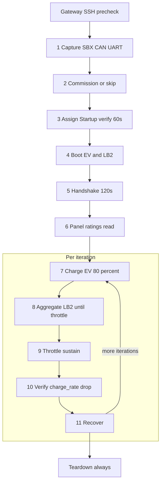

# Drive Automation

One-click SPAN Drive charge-point test pipeline for the lab cell:

- **EV Simulator (LB1 `:8091`)** + **Load Bank-2 (`:8080`)** — same HTTP clients / access as before
- **Gateway** (mandatory SSH precheck; optional Phase 2 commission) via direct lab-LAN SSH — **preferred: CA certificate** (`~/.ssh/id_ecdsa` + `id_ecdsa-cert.pub` on the lab cell)
- **Dynamic LB2 throttle** — follows panel `charge_rate_a` first, then pilot advertised current (not a fixed hold)
- **Decommission** is a **separate** dashboard/CLI action — never part of one-click teardown

Dashboard UX follows lucid JAMA one-click patterns: **sidebar nav**, section cards (Pipeline / Live / Safety / Gateway / Decommission / Logs), overview metric strip, and pipeline live panel.

## Daily use (operators)

The dashboard runs **continuously** on each wall PC as the **`drive-dashboard`** systemd service (same pattern as Lucid’s `lucid-dashboard`). Operators do **not** need to SSH in or run `./run_dashboard.sh` before using the UI.

1. Open **Chrome** (on the wall PC or a laptop on the lab network).
2. Enter **`http://<wall-ip>:8765`**.

**If the page will not load**, on that wall PC:

```bash
sudo systemctl status drive-dashboard
sudo journalctl -u drive-dashboard -n 50 --no-pager
sudo systemctl start drive-dashboard      # if it is stopped
sudo systemctl restart drive-dashboard    # after a code deploy
```

Follow logs live: `sudo journalctl -u drive-dashboard -f`

## Multi-wall setup (recommended)

One **env file per wall PC**. Deploy + generate `config.env` on the wall in one command.

### Fastest: interactive wizard

```bash
./setup.sh
```

`setup.sh` is a guided end-to-end wizard: it collects the wall details and passwords,
writes `walls/<name>.env` (and optionally `walls/_shared.env`), validates them, then
deploys, writes the remote `config.env`, bootstraps the venv, and can start the
dashboard — all in one run. It also lists existing wall configs so you can reconfigure
or redeploy. The manual steps below are the same building blocks it calls.

### 1. Shared passwords (optional, all walls)

```bash
cp walls/_shared.env.example walls/_shared.env
# edit PANEL_SSH_PASS, DRIVE_PASSWORD
```

### 2. Create a wall env file

```bash
# Scaffold from template:
./new_wall.sh 10.91.0.89 in-qa-wall-001 XG-2532-3HLKT

# Or copy an example:
cp walls/in-qa-wall-001.env.example walls/in-qa-wall-001.env
```

Edit `walls/<name>.env` — mainly `WALL_IP`, `WALL_GATEWAY_SERIAL`, SBX USB settings.

### 3. Deploy + configure + bootstrap

```bash
./setup_wall.sh walls/in-qa-wall-001.env          # first time (writes config.env)
./setup_wall.sh walls/in-qa-wall-001.env --start  # deploy + install systemd unit
./setup_wall.sh --list                            # show wall env files
```

Re-run with `--force-config` to regenerate remote `config.env` from the wall env file.

Preview generated config (no deploy):

```bash
./setup_wall.sh walls/in-qa-wall-001.env.example --render
```

| Wall env variable | Becomes on the wall PC |
|-------------------|------------------------|
| `WALL_IP` | `CAPTURE_SSH_HOST` + dashboard URL |
| `WALL_SSH_USER` | `CAPTURE_SSH_USER`, remote paths |
| `WALL_GATEWAY_SERIAL` | default gateway serial |
| `GATEWAY_SERIALS` | log-capture dropdown list |
| `DRIVE_SBX_*` | FT232R USB device for SBX logs |

Ensure `panels_config.yml` has an entry for `WALL_IP` with `gateway_serial` + `user_name`.

### Quick code-only deploy (legacy)

```bash
DRIVE_LAB_HOST=qa@10.91.0.89 ./deploy_to_lab.sh
```

Does **not** overwrite remote `config.env`.

## Quick start (on wall PC)

One-time (installs the always-on service, then it survives logout and reboot):

```bash
cd ~/drive_automation
./scripts/install_dashboard_service.sh
# Open http://<WALL_IP>:8765
```

After that, only systemd commands are needed:

```bash
sudo systemctl start drive-dashboard
sudo systemctl stop drive-dashboard
sudo systemctl restart drive-dashboard
sudo journalctl -u drive-dashboard -f
```

`./run_dashboard.sh` is for **debug only** (foreground terminal). Do not use it on a wall that already has the service, or it will fight for port 8765.

## Pipelines

There are two separate dashboard flows:

1. **Throttle Pipeline** (EV + LB2) — load-bank throttle / recover. Does **not** run advertise/comms JAMA cases.
2. **JAMA Test** (EV + gateway only) — advertise / comms cases. Snapshots mutable state at start and always restores it on exit (pass or fail). Select cases via the UI or `DRIVE_CASES` in config.env.

**Decommission** remains a separate dashboard action (never part of either pipeline).

### Throttle pipeline phases

The **Throttle Pipeline → Run** button starts a single automated test run. Phases match `PIPELINE_PHASES` in the orchestrator, appear in the sidebar stepper, and stream as JSON events on `/api/events` (SSE).

A **user-supplied phase delay** (same value for all phases) is inserted between every transition.

**Gateway SSH is mandatory** before Phase 1. The run fails early if `GATEWAY_SSH_HOST` is unreachable. Teardown always runs after the last phase (or on error/cancel).



### JAMA Test pipeline

Dashboard **JAMA Test** section. Requires EV Simulator login + gateway SSH + `DRIVE_BREAKER_INSTANCE_ID`. No LB2.

Phases: `capture` → `boot` → `handshake` (SBX comms) → `snapshot` → `jama_test` → `restore` (always).

Every gateway SSH command is streamed to the dashboard activity log (`gateway_cmd`) and listed in the HTML report with timestamps. Each JAMA case shows recorded time plus log-analysed time from Modbus/evidence.

Cases (aliases for `DRIVE_CASES` / UI checkboxes): `advertise_rates`, `obeys_breaker`, `comms_loss`, `comms_required`, `no_comms_boot`, `set_charge_rate_0`, `power_reset`.

### Throttle phase summary

| # | Name (`PIPELINE_PHASES`) | Skipped when |
|---|--------------------------|--------------|
| — | Gateway SSH precheck | Never (hard fail if unreachable) |
| 1 | `capture` | Never |
| 2 | `commission` | Checkbox off |
| 3 | `post_commission_verify` | Never (soft: missing msgs → continue) |
| 4 | `boot` | Never |
| 5 | `handshake` | Never (soft verify) |
| 6 | `panel_ratings` | Never |
| 7 | `charge` | Never (per iteration) |
| 8 | `aggregate` | LB2 off or legacy mode |
| 9 | `throttle` | LB2 off or legacy mode |
| 10 | `verify` | LB2 off or legacy mode |
| 11 | `recover` | LB2 off (pilot still returns to Watch) |
| — | Teardown | Never (`finally`) |

Phases **7–11** repeat for `iterations` (dashboard default 1). **Stop** sets `_stop_check` and exits the loop cleanly.

---

### Phase 1 — Capture

Start local SBX + CAN + UART on the wall PC (not gateway). Report start time and data availability per stream.

A decommissioned Drive may produce no SBX frames yet — that is not a hard failure; check again after commissioning. Unified SBX start failure is hard-fail; UART is best-effort; `charge_rate` hard-ready is deferred until after commission.

**Events:** `capture_stream_status` (also `gateway_ready` from the precheck).

---

### Phase 2 — Commission (optional)

**When:** Only if the **Commission** checkbox is enabled. Off → **Commission was skipped**.

**What happens:**

1. **SSH to gateway** as `root` (CA cert preferred; password fallback).
2. **Operator-supplied breaker positions** — `bc_id = position + 8`.
3. **Create DER 2-pole breaker** at the required rating.
4. **Write retained MQTT shadows** and publish with retain.
5. **Restart** `span-sbx-seriald` and `span-eve`.
6. **Discovery** until `DISCOVERY_SUCCESSFUL` (~90 s) or fail.

**Key config:** `GATEWAY_SSH_HOST`, `DRIVE_SERIAL`, breaker positions (if commissioning), breaker rating (always).

**Events:** `commission_complete`, `commission_report`.

---

### Phase 3 — Post-commission verify (60 s, soft)

Wait ~60 s, then scan the Modbus log for AssignDynamicBusId (`0x2000`)+Ack and DriveStartupRequest+DriveStartup. Missing → **not observed**, continue (does not abort).

**Events:** `sbx_msg_verify`.

---

### Phase 4 — Boot

1. Availability re-check — EV free; LB2 required if enabled.
2. Login EV (`:8091`) / LB2 (`:8080`).
3. `wait_ready()` — fails fast on MODE_SELECT / `startup_status=error`.

**MODE_SELECT:** EV contactor bank is selected by the EV Simulator Pi on login. Drive Automation does not drive that coil. Safe exit returns LB (NC) default.

**Events:** `availability`, `login_ev`, `ev_ready`, `lb2_ready`.

---

### Phase 5 — Handshake (120 s, soft)

Verify cyclic SBX pairs (Heartbeat, FirmwareVersion, image versions, CpuUtil, CommStatus, FaultCount). Each row: observed / not observed + evidence. Soft — does not abort. Also samples `charge_rate`.

**Events:** `handshake_verify`, `panel_status`.

---

### Phase 6 — Panel ratings (read-only)

Via gateway `span-pcm mt panel get`: site utility, conductor, busbar (and feeder breaker if present). Compute **limit = min(...)** and **80% threshold**. Sample live feeder amps via `traits-cli` (panel meter max = limit). Does **not** write/set ratings on the panel.

**Events:** `panel_ratings`, `feeder_amps`.

---

### Phase 7 — Charge (per iteration)

**EV draw sequence** (new EV Simulator Switch ON/OFF Loads):

1. Pilot **Watch → Connect → wait PWM → Charge** (`set_mode` only — Charge no longer arms loads).
2. **Switch ON Loads** — `POST /api/ev/loads` `{ "action": "on", "amps": <80% of breaker>, "approach": "undershoot", "monotonic": true }` (timeout ~30 s). Undershoot-only (never command above target); exact amps when achievable (e.g. 44 A → 44 A). **EV Pi firmware must honor `approach=undershoot`** for the Drive OC fix.
3. LB2 delay / voltages / aggregate–throttle–recover (as configured).
4. **Switch Off Loads** — `POST /api/ev/loads` `{ "action": "off" }` (timeout up to ~180 s; wait until `loads_armed` is false).
5. Pilot **Connect → Watch** (must not call while loads still armed — else HTTP 409).

`set_max_current(amps)` in the client now arms loads via Switch ON (cap-only: `set_max_current_cap`). Deploy updated EV Simulator to LB1 first if `/api/ev/loads` returns 404.

**Events:** `pilot_mode`, `pilot_pwm`, `ev_charging`, `ev_loads_off`, `lb2_voltages`.

---

### Phase 8 — Aggregate (dynamic LB2, default)

**Purpose:** Increase LB2 until the panel throttles (`charge_rate_a` drops). Emit load-increase then **throttling started** with panel load, duty, drive current.

**Only when:** `use_lb2` and dynamic load enabled (default).

**Charge rate source:** live SBX log.

**Loop** (until fully throttled / ceiling / cancel):

- Baseline `charge_rate_a`, step LB2 up.
- On first drop → **`throttle_engaged`** (“Throttling started”).
- Keep stepping until `charge_rate_a ≤ 6 A` (**`throttle_step_6a`**), then until `charge_rate_a == 0 A` (**`throttle_zero`**).
- The EV/charge-point load always tracks the pilot duty cycle on its own throughout.

**Events:** `aggregation_start`, `aggregation_sample`, `throttle_engaged`, `throttle_step_6a`, `throttle_zero`, `aggregation_ceiling`, `aggregation_timeout`.

---

### Phase 9 — Throttle (sustain)

**Purpose:** Hold the throttled state so the drop is demonstrably stable.

**Bounded by:** sustain / verify timeout (dashboard **“Sustain / verify timeout”**, default **~90 s**).

**Events:** `throttle_sustain_start`.

---

### Phase 10 — Verify

**Purpose:** Confirm throttle is **physically real** — SBX `charge_rate_a` is still below the recorded baseline (panel reduced the Drive request), not just a one-sample glitch.

On success emits **`throttle_verified`** with current `charge_rate_a` and baseline.

---

### Phase 11 — Recover

**Purpose:** Step panel load back to 0 the same way it was raised, and confirm the panel restores the drive request as total current falls.

1. **Step LB2 commanded amps down** symmetrically (same step, same delay) until 0.
2. After **each** down-step, read SBX `charge_rate_a` and emit **`recovery_step`** — the panel should send an **increased** current to the drive as panel load decreases.
3. Finish at 0 load; emit **`recovery_verified`** when `charge_rate_a` returns to ≥ **85%** of baseline, or **`recovery_timeout`** if not.

Then for that iteration: pilot **Connect → Watch** before the next iteration starts.

**Events:** `recovery_start`, `recovery_step`, `recovery_verified`, `recovery_timeout`.

---

### End of run — teardown (always)

Runs in a `finally` block — **even on error or cancel**:

| Step | Action |
|------|--------|
| Save test | `test_save()` on EV (best effort) |
| Export | Download `.evtest.zip` while still logged in |
| Telemetry | Stop background sampler |
| Safe exit | EV and/or LB2 stop → shutdown → wait → logout |
| Artifacts | Package run JSONL + EV zip → combined download zip on wall PC |

Emit **`artifact_ready`** with `/api/artifacts/<run_id>/download` URL.

**One-click never:** deletes the DER breaker, clears MQTT shadows, or runs decommission. Use the separate **Decommission** card for that.

---

### Legacy LB2 mode (non-dynamic)

If **dynamic load** is unchecked, Phases **8–10** are replaced by a simpler path:

- Ramp LB2 to fixed `lb2_max_amps`
- **Hold** for `throttle_duration_sec` (fixed sleep)
- Ramp down
- **Recovery** sleep for `recovery_duration_sec`

Prefer dynamic mode for panel-following throttle tests.


## LB2 unavailable

When **Load Bank-2 is in use**, the run **fails immediately** with reason **“LB2 not available.”** There is no skip-LB2 popup — free the load bank (or the other operator's session) and re-run.

## Gateway SSH (lab cell → gateway)

**Preferred (no long-term CA cert):** spanssh-config generated for the panel serial:

```bash
ssh -F ~/.ssh/span/XC-2610-3JFDY/spanssh-config XC-2610-3JFDY
```

In `config.env` on the wall:

```bash
GATEWAY_SERIAL=XC-2610-3JFDY
GATEWAY_SSH_AUTH=auto
# optional LAN fallback if spanssh-config is missing:
# GATEWAY_SSH_HOST=10.91.0.224
```

`GATEWAY_SSH_AUTH=auto` prefers `~/.ssh/span/<GATEWAY_SERIAL>/spanssh-config` when present.
Legacy cert (`~/.ssh/id_ecdsa` + `id_ecdsa-cert.pub`) and password remain fallbacks.

Dashboard **Gateway → Test gateway SSH** exercises the same path.

## Separate decommission

Dashboard **Decommission** card or:

```bash
# via API
curl -X POST http://localhost:8765/api/decommission \
  -H 'Content-Type: application/json' \
  -d '{"client_id":"...","confirm":true,"breaker_instance_id":27}'
```

## Environment (`config.env`)

| Variable | Default |
|----------|---------|
| `DRIVE_EV_URL` | `http://10.91.1.51:8091` |
| `DRIVE_LB2_URL` | `http://10.91.1.66:8080` |
| `DRIVE_OPERATOR` | `Automation` |
| `DRIVE_PASSWORD` | Pi SSH password (LB1/LB2) |
| `GATEWAY_SERIAL` | panel serial — spanssh host + `~/.ssh/span/<serial>/` |
| `GATEWAY_SSH_AUTH` | `auto` (prefer spanssh-config) \| `spanssh` \| `cert` \| `password` |
| `GATEWAY_SSH_HOST` | optional LAN IP fallback |
| `GATEWAY_SSH_USER` | `root` (LAN fallback) |
| `GATEWAY_SSH_IDENTITY` | legacy cert key `~/.ssh/id_ecdsa` |
| `GATEWAY_SPANSSH_CONFIG` | optional explicit `spanssh-config` path |
| `GATEWAY_SSH_PASS` | optional password fallback only |
| `DRIVE_SERIAL` | Drive serial for commission |
| `DRIVE_DASHBOARD_PORT` | `8765` |

## SBX hex decode (Drive bus)

Unlike Lucid Modbus (fixed 7/8-byte RTU), Drive SBX frames have **variable PayloadLen (N)**:

```text
[ 0x60 | Ver(1) | RcvrID(2) | SndrID(2) | HdrCRC(2)
      | TxnID(1) | MsgTypeID(2) | PayloadLen(1)
      | Payload(N) | PayloadCRC(2) | 0x62 ]
```

```bash
# Continuous hex dump (spaces/newlines OK) → one-line summaries
python3 updatedd_log.py decode sample.hex --summary

# Full frame dump / JSON
python3 updatedd_log.py decode sample.hex
python3 updatedd_log.py decode sample.hex --json -o decoded.jsonl
```

MsgTypeIDs follow the Sbx decode sheet (`MsgDriveStatus` `0x1001`, `MsgAck` `0xF000`, …).

## Dashboard log cards (CAN / SBX / UART)

Lucid-style capture: pick a **gateway serial** from the dropdown; the server resolves
`user@host` + password from `panels_config.yml`.

| Env | Purpose |
|-----|---------|
| `GATEWAY_SERIALS` | Comma-separated serials for dropdown |
| `PANEL_CONFIG_PATH` / `GATEWAY_CAPTURE_CONFIG_PATH` | `panels_config.yml` on dashboard host |
| `PANEL_SSH_PASS` | Wall SSH password (not sent to browser) |
| `DRIVE_SBX_SERIAL` | Filter FT232R adapter by USB `SER=` from `pio device list` |
| `DRIVE_SBX_PORT` | **Force** path (e.g. `/dev/ttyUSB0`) — set this so ST-Link `ttyACM*` is never used |
| `DRIVE_SBX_SERIAL_STRICT` | `1` = fail if `DRIVE_SBX_SERIAL` matches nothing |

**SBX device detection** (same order as lucid `updatedd_log._pick_modbus_device`, plus FT232R):
1. `DRIVE_SBX_PORT` if that path exists on the capture host
2. `pio device list` → FT232R (`0403:6001` / `FT232R USB UART`), optional `DRIVE_SBX_SERIAL`
3. Description contains `USB Single Serial` (lucid Modbus adapter)
4. Any `/dev/ttyUSB*` (not Pico / debugger)
5. `/dev/ttyACM*` only as last resort — **never** ST-Link / Pico / empty description

```bash
# Example wall PC / lab-cell config.env
GATEWAY_SERIALS=XC-2543-33KE3,XG-2521-3AGFT
PANEL_CONFIG_PATH=/home/qa/drive_automation/panels_config.yml
PANEL_SSH_PASS=…
DRIVE_SBX_PORT=/dev/ttyUSB0
DRIVE_SBX_SERIAL=BG01DJEP
DRIVE_SBX_SERIAL_STRICT=1
```

## Output

- JSON lines on stdout / SSE (`/api/events`)
- `logs/run_YYYYMMDD_HHMMSS.jsonl`
- `capture_sessions/<id>/` CAN + SBX + UART captures
- `artifacts/run_.../` combined zip + **`drive_report.html`** (JAMA-style)
- Events: `pipeline_phase`, `jama_case`, `load_setpoint`, `throttle_engaged`, `throttle_verified`, `recovery_verified`, `artifact_ready`, …

### JAMA-style run report

Each run writes `artifacts/<run_id>/drive_report.html` with:

- Summary strip: Tests / Passed / Failed / Pass rate / Overall
- Per-case cards (SIGNAL / EXPECTED / OBSERVED / SOURCES) with **Notes — log evidence** from Modbus
- **SBX** cases (`DRIVE-SBX-####`) for Assign/Startup + handshake pairs
- **Throttle** cases (`DRIVE-THR-####`) for each LB2 up-step (default +5 A) with `charge_rate_a` evidence
- **Recover** cases (`DRIVE-REC-####`) for each down-step

Pipeline soft-continues on missing SBX pairs; those cases still count as FAIL in the report. See [`docs/draft_report/`](docs/draft_report/) for a sample.

## API

| Endpoint | Method | Purpose |
|----------|--------|---------|
| `/api/availability` | GET | Check EV/LB2 free |
| `/api/run` | POST | Start one-click pipeline |
| `/api/stop` | POST | Cancel run |
| `/api/gateway/test` | POST | Probe gateway SSH |
| `/api/decommission` | POST | Separate decommission (`confirm: true`) |
| `/api/events` | GET (SSE) | Live JSON events |
| `/api/artifacts/<run_id>/download` | GET | Combined zip |
| `/api/artifacts/<run_id>/report` | GET | JAMA HTML report |
